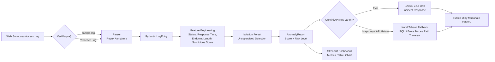

# 🛡️ LogPulse

### AI Destekli Log Analiz ve Anomali Tespit Motoru

[](https://www.python.org/)
[](https://scikit-learn.org/)
[](https://streamlit.io/)
[](https://docs.pydantic.dev/)
[](https://ai.google.dev/)

LogPulse, web sunucusu erişim loglarını analiz eden ve güvenlik ekiplerinin şüpheli olayları hızlıca önceliklendirmesine yardımcı olan Python tabanlı bir siber güvenlik uygulamasıdır. Sistem, etiketlenmiş saldırı verisine ihtiyaç duymadan Isolation Forest ile anomali tespiti yapar; tespitleri risk seviyelerine ayırır ve Gemini AI veya güvenilir kural tabanlı fallback mekanizmasıyla Türkçe olay müdahale raporuna dönüştürür.

## 🎯 Çözdüğü Siber Güvenlik Problemi

Geleneksel log inceleme süreçleri büyük hacimli erişim kayıtlarında gözden kaçan saldırı göstergelerine ve yavaş müdahaleye neden olabilir. LogPulse:

- Olağandışı HTTP durum kodlarını ve yanıt sürelerini belirler.
- Uzun veya şüpheli endpoint'leri analiz eder.
- SQL Injection, Brute Force ve Path Traversal göstergelerini işaretler.
- Anomalileri `Düşük`, `Orta` ve `Yüksek` risk seviyeleriyle önceliklendirir.
- 401/403 kayıtlarını gerçek 300 saniyelik ileri kayan pencereyle değerlendirir.
- Kural tabanlı, yalnızca ML ve hibrit tespit sayılarını ayrı gösterir.
- Güvenlik analistleri için kanıta dayalı müdahale önerileri üretir.

## 🏗️ Sistem Mimarisi ve Veri Akışı



### Modül Sorumlulukları

| Modül | Sorumluluk |
|---|---|
| `models.py` | `LogEntry` ve `AnomalyReport` Pydantic veri modelleri |
| `parser.py` | Ham `.log` satırlarını regex ile ayrıştırma |
| `analyzer.py` | Feature engineering, Isolation Forest ve olay raporlama |
| `app.py` | Streamlit kontrol paneli ve kullanıcı etkileşimi |
| `test_logpulse.py` | Parser ve analyzer birim testleri |

## ⚙️ Öne Çıkan Mühendislik Özellikleri

### Gözetimsiz Anomali Tespiti

`IsolationForest`, önceden etiketlenmiş saldırı verisine ihtiyaç duymadan log davranışlarındaki aykırı gözlemleri tespit eder. Model; HTTP durum kodu, yanıt süresi, endpoint uzunluğu ve şüpheli ifade skorunu birlikte değerlendirir.

### Pydantic ile Veri Doğrulama

`LogEntry` ve `AnomalyReport` modelleri, parser ile analiz katmanı arasında tip güvenli ve doğrulanmış bir veri sözleşmesi sağlar. Risk seviyesi yalnızca `Düşük`, `Orta` veya `Yüksek` olabilir.

### LLM + Kural Tabanlı Yedek Raporlama

Gemini API anahtarı sağlandığında Gemini 2.5 Flash'a ham log (`raw_log`) gönderilmez. Yalnızca zaman, maskelenmiş IP, HTTP metodu, maskelenmiş endpoint, durum kodu, risk seviyesi ve tetiklenen kural gibi yapısal özet alanları gönderilir. Maskeleme; IP, parola, token ve e-posta gibi belirli desenleri gizleyen yardımcı bir önlemdir, tam bir anonimleştirme veya veri kaybı önleme garantisi değildir. API anahtarı yoksa veya API çağrısı başarısız olursa sistem kesintiye uğramadan kural tabanlı raporlamaya geçer. Bu tasarım harici AI servisine bağımlılığı azaltır ve operasyonel süreklilik sağlar.

### Test Edilebilir ve Modüler Tasarım

Parser'ın geçerli/bozuk satır davranışları, Isolation Forest çıktıları ve fallback raporları pytest ile doğrulanır. Modül sınırları, bileşenlerin bağımsız test edilmesini kolaylaştırır.

### Analist Odaklı Dashboard

Streamlit arayüzü toplam log sayısını, anomali sayısını, ortalama yanıt süresini ve en yüksek riski tek bakışta gösterir. Detay tablosu ve yanıt süresi grafiği, olayların hızlı triage edilmesini destekler.

## 🚀 Kurulum

Python 3.10 veya üzerinin kurulu olduğundan emin olun.

```bash
git clone <repository-url>
cd LogPulse

python -m venv venv
```

Windows:

```powershell
.\venv\Scripts\Activate.ps1
```

Linux/macOS:

```bash
source venv/bin/activate
```

Bağımlılıkları yükleyin:

```bash
pip install -r requirements.txt
```

## ▶️ Çalıştırma

Streamlit kontrol panelini başlatın:

```bash
streamlit run app.py
```

Tarayıcıda gösterilen yerel adrese gidin. Sidebar üzerinden `sample.log` dosyasını analiz edebilir, yeni bir `.log` dosyası yükleyebilir veya Gemini API Key sağlayabilirsiniz.

Gemini anahtarı isteğe bağlıdır. Anahtar paylaşılmadığında kural tabanlı olay müdahale raporu kullanılır. API anahtarlarını kaynak koduna veya Git deposuna eklemeyin; yerel ortam değişkenleri ya da güvenli secret yönetimi kullanın.

AI önizlemesi ve Gemini isteği aynı maskelenmiş JSON payload'ını kullanır; parola,
token, e-posta ve URL-kodlu hassas parametreler gönderilmeden önce maskelenir.

## 🧪 Test

Testleri çalıştırın:

```bash
pytest
```

Beklenen test kapsamı:

- Geçerli erişim logu ayrıştırma
- Bozuk satırları atlama
- Eksik dosya davranışı
- Anomali raporu üretimi
- Yüksek riskli şüpheli istek tespiti
- SQLi ve Path Traversal fallback raporu
- 100 normal istekte sıfır anomali ve tekrarlı giriş denemelerinde Brute Force tespiti
- Common/Combined Log Format ayrıştırma ve atlanan satır istatistikleri
- Hassas veri maskeleme ve sıfır anomali raporu
- Beş dakikalık zaman pencereli 401/403 Brute Force analizi ve kayıt bazlı tetiklenen kural açıklamaları

## 📄 Lisans

Bu proje eğitim, portföy ve güvenlik analizi prototipleme amacıyla geliştirilmiştir. Üretim ortamında kullanmadan önce log gizliliği, API anahtarı güvenliği, model kalibrasyonu ve kurumunuzun olay müdahale süreçleri doğrulanmalıdır.